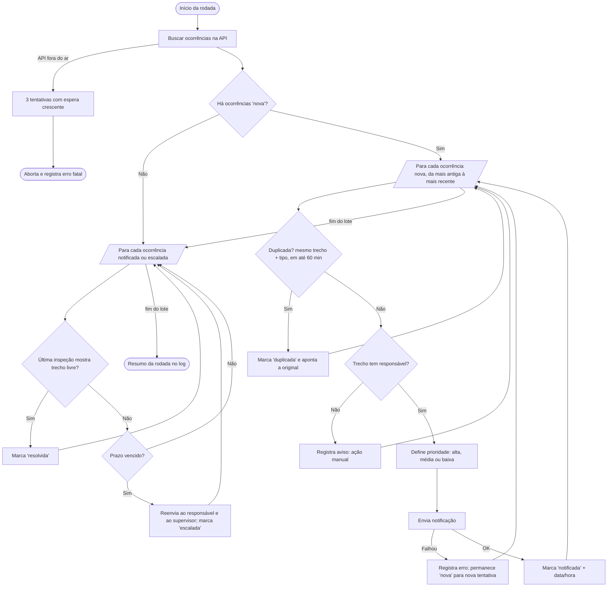

# Fluxo da automação (para o PDD / BPMN)

Prazos por prioridade: alta 30 min, média 120 min, baixa 480 min.
Para entregar em BPMN: redesenhe este fluxo em https://demo.bpmn.io (ou Bizagi) e exporte a imagem.
